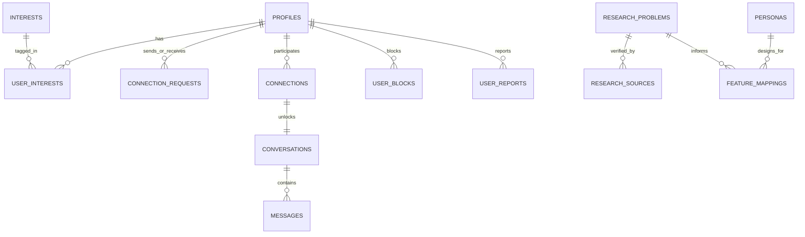

# CommonGround — University Research Suite & Prototype

> **Human-Centered Design, Social Computing, and Ethical Technology Showcase**  
> An evidence-informed investigation into modern social disconnection, the people excluded by current meeting paradigms, and an interactive consent-first prototype.

🌐 **Live URL:** [https://commonground-p2ia.onrender.com/](https://commonground-p2ia.onrender.com/)

---

CommonGround is organized into three connected academic modules:

1. 🔍 **Module 1: The Problem Detective** — Evidence-based diagnostic dashboard investigating the empirical failures of existing meeting methods (*"What is going wrong in how people meet, and for whom?"*).
2. 👥 **Module 2: The People Left Out** — Human-Centered Design research dashboard featuring 3 detailed user personas, 5 barrier categories, 6 meeting methods analyzed, and a traceable feature mapping (*"Who struggles to connect, and what prevents them?"*).
3. 🚀 **Module 3: The Solution Architect** — Interactive, full-stack connection platform backed by persistent PostgreSQL database with interest-first discovery, mutual introduction requests, realtime chat, and dignified safety controls.

---

## ⚡ Full-Stack Transformation & Architecture

CommonGround is built as a production-grade full-stack web application designed for high security, data integrity, and explainable multi-user interaction.

### System Stack

| Layer | Technology | Responsibilities |
|---|---|---|
| **Frontend UI** | React 18, TypeScript, Tailwind CSS, Lucide Icons | Responsive multi-module interface, accessible design system, explainable compatibility breakdowns. |
| **Routing & Shell** | React Router DOM (`/module-1`, `/module-2`, `/module-3`) | Deep linking, browser history preservation, persistent navigation shell. |
| **Data & State** | React Context (`AppContext`), Service Layer Pattern | Optimistic updates, session caching, state rollbacks, realtime chat subscriptions. |
| **Database & Auth** | Supabase (PostgreSQL 15), Supabase Auth | User authentication, relational data persistence, canonical connections, audit timestamps. |
| **Access Control** | Supabase Row Level Security (RLS) | Security Definer functions (`is_editor_or_admin()`, `is_blocked_with()`), column privacy. |
| **Live Updates** | Supabase Realtime (`postgres_changes` WebSocket) | Instant messaging synchronization across active chat conversations. |

---

### Database Schema Overview

The relational PostgreSQL database is designed across four modular migrations in `supabase/migrations/`:



1. **`profiles`**: Linked to `auth.users(id)` with cascade deletion. Contains display names, bio, intentions, communication preferences, and private accessibility accommodations.
2. **`interests` & `user_interests`**: Many-to-many controlled interest taxonomy (Specialty Coffee, Analog Photography, Hiking, etc.).
3. **`connection_requests`**: Mutual introductions with state machine (`pending`, `accepted`, `declined`, `cancelled`). Enforces unique pending requests per user pair.
4. **`connections`**: Canonical pairwise relationships (`user1_id < user2_id`). Only created upon mutual acceptance.
5. **`conversations` & `messages`**: 1-on-1 private messaging channels unlocked only by active connections, with foreign key integrity and Realtime listening.
6. **`user_blocks` & `user_reports`**: Confidential safety actions that prevent discovery, block new introductions, and log moderation reports securely.
7. **`research_problems` & `research_sources`**: Module 1 empirical problems and academic source citations with editable composite scores for authorized editors.
8. **`personas` & `feature_mappings`**: Module 2 human-centered archetypes (Aanya, Rohan, Meera) with customizable goals and traceable feature mappings.

---

### Security & Row Level Security (RLS)

All database operations enforce Row Level Security:
- **Profile Privacy:** Users can only modify their own profile records. Accessibility preferences are private by default.
- **Connection Isolation:** Users can only view connection requests where they are the sender or recipient.
- **Strict Chat Authorization:** Only accepted participants of a canonical connection can read or insert chat messages.
- **Defensive Blocking:** Discoverable profiles, connection requests, and messages are automatically filtered if a block relationship exists (`is_blocked_with()`).
- **Editor Privileges:** Modification of shared research findings and user personas is strictly restricted to authenticated users with `editor` or `admin` roles (`is_editor_or_admin()`). Standard visitors receive read-only simulation access.

---

### Dual-Mode Backend Resilience

The application features **Dual-Mode Backend Resilience**:
1. **Live Cloud Database Mode (Default with credentials):** When `VITE_SUPABASE_URL` and `VITE_SUPABASE_ANON_KEY` are provided, the app connects directly to PostgreSQL with realtime WebSockets, persistent auth, and full RLS.
2. **Local Demonstration Mode (Graceful Fallback):** When no hosted database credentials are configured (e.g., initial local checkout or sandbox evaluations), the app seamlessly falls back to local in-memory/localStorage demonstration mode. A visual status indicator in the top header clearly identifies active backend status (`Live Database` vs `Demo Mode`).

---

### Setup Instructions

#### 1. Local Development
```bash
# Clone the repository
git clone https://github.com/VANSHNDTECH/soul_society-.git
cd soul_society-

# Install dependencies
npm install

# Start development server
npm run dev
```

#### 2. Connecting Hosted Supabase (Optional for Live Database)
1. Create a free PostgreSQL project at [supabase.com](https://supabase.com).
2. Go to the **SQL Editor** in your Supabase Dashboard.
3. Open [`supabase/setup.sql`](file:///e:/AICLUB/soul_society-/supabase/setup.sql), copy its contents, and click **Run**. (This sets up all tables, triggers, RLS policies, and seed data in one step).
4. Create a `.env.local` file in the project root:
   ```env
   VITE_SUPABASE_URL=https://your-project-id.supabase.co
   VITE_SUPABASE_ANON_KEY=your-supabase-anon-public-key
   ```
5. Restart your dev server (`npm run dev`). The header badge will immediately switch to 🟢 **Live Database**.

#### 3. Quick-Switch Presentation Accounts
The app header includes a user account modal allowing evaluators to switch roles on the fly:
- **Student User (`user`):** Maya Lin (explore discovery, send introductions, chat).
- **Research Editor (`editor`):** Dr. Elena Rostova (can edit research problem prioritization scores and update personas).
- **System Admin (`admin`):** Full database administrative permissions.

---

## 👥 Module 2: The People Left Out

### The Central Research Question
> **"Who struggles to make meaningful connections, what prevents them from doing so, and how can a more inclusive, low-pressure, consent-based platform help?"**

---

### 1. Three Detailed User Personas (Research Hypotheses)

All personas are grounded in secondary literature and qualitative inquiry, explicitly labeled as research hypotheses subject to primary field validation.

#### Persona 1: Aanya Sharma (19) — The Quiet College Freshman
- **Archetype & Context:** First-year university student who transitioned to a large campus. Wants to cultivate 2–3 close, genuine friendships but experiences sensory drain and acute anxiety during cold approaches.
- **Primary Goal:** Form a small circle of authentic friends without the pressure of approaching unfamiliar peers in crowded campus spaces.
- **Pain Points:** Freezes up in small talk; finds orientation mixers and frat parties overwhelming; fears being perceived as intrusive; exhausted by superficial swipe apps.
- **Unmet Needs:** Low-pressure introductions; shared-interest conversation starters; mutual consent before 1-on-1 private messaging; guilt-free quiet decline mechanics.
- **Current Workarounds:** Sits in quiet library zones with headphones; waits passively for extroverted peers to initiate; lurks silently in campus Discord servers.
- **Design Opportunity:** Double-blind mutual introductions with shared-interest icebreakers and asynchronous interaction pacing.
- **Illustrative Quote:** *"I don’t need fifty acquaintances at an orientation mixer. I just want two or three kind people who want to talk about books over hot tea without me having to perform."*

#### Persona 2: Rohan Mehta (23) — The Relocated Newcomer
- **Archetype & Context:** Recent engineering graduate who moved to a new metropolitan city for his first professional job. Motivated to socialize but lacks an established local network.
- **Primary Goal:** Meet nearby people who share his weekend hobbies (hiking, board games) outside work without interactions feeling like LinkedIn networking.
- **Pain Points:** Doesn't know where local hobbyists gather; intimidated by pre-existing tightly knit friend groups; constrained free time after work; high venue entry fees.
- **Unmet Needs:** Interest-first discovery; compatible intention signals (platonic vs. dating); flexible social scheduling; affordable activity coordination.
- **Current Workarounds:** Attends generic Meetup events where turnouts are unpredictable; spends weekends browsing Reddit city guides; joins coworkers for drinks that stay strictly professional.
- **Design Opportunity:** Activity-partner matching connecting users over low-cost local passions and transparent platonic intentions.
- **Illustrative Quote:** *"Moving to a new city means starting your social life from zero. My coworkers are great, but I want friends to hike trails or play board games with on weekends without it feeling like a LinkedIn networking event."*

#### Persona 3: Meera Iyer (25) — The Niche & Accessible Explorer
- **Archetype & Context:** Working professional with specialized creative interests (ceramics, analog photography) and chronic sensory/mobility requirements that dictate physical comfort.
- **Primary Goal:** Connect with kindred spirits who genuinely share her creative craft without having to repeatedly explain or justify her physical accessibility needs.
- **Pain Points:** Mainstream platforms emphasize looks over niche passions; popular social venues are often noisy, crowded, or physically inaccessible; reluctance to disclose medical details to strangers.
- **Unmet Needs:** Precision interest tagging; optional, user-controlled accessibility badges; low-sensory interface modes; verified venue accessibility info; robust privacy controls.
- **Current Workarounds:** Engages in niche online forums that lack local connection; declines social invitations to loud, inaccessible venues; hides personal constraints.
- **Design Opportunity:** Accessible profile controls, dignified sensory pacing badges, privacy by default, and high-visibility interest taxonomy.
- **Illustrative Quote:** *"I love discussing experimental darkroom techniques, but I can't do loud bars with bad lighting and zero seating. I want people to see my creativity first, not my physical accommodations."*

---

### 2. Five Connection Barrier Categories (15 Obstacles)

1. **Emotional Barriers:**
   - *Fear of Rejection & Social Hesitation:* Anticipation of negative evaluation creates paralysis.
   - *Initiation Friction & Small-Talk Freezing:* High cognitive tax of inventing opening remarks with cold strangers.
   - *Social Battery Exhaustion:* Intense sensory and cognitive depletion from performative socializing.
2. **Structural Barriers:**
   - *Time Scarcity & Professional Fatigue:* Rigorous work hours conflict with casual socializing (Hall 2018: ~50h required for friendship).
   - *Financial Gatekeeping:* High costs of commercial third places (cocktail bars, ticketed events).
   - *Social Network Disconnection:* Total absence of local social capital following relocation or life transitions.
3. **Discovery Barriers:**
   - *Superficial Lookism & Visual Cataloging:* Mainstream apps optimize for rapid facial appraisal over intellectual compatibility.
   - *Niche Passion Invisibility:* Difficulty finding peers interested in specific crafts or subcultures in local areas.
   - *Intention Asymmetry:* Unstated, mismatched expectations (seeking platonic friendship vs. romantic advances).
4. **Accessibility & Inclusion Barriers:**
   - *Sensory Hostility:* High-decibel, flashing, or crowded environments exclude neurodivergent and chronic-fatigue individuals.
   - *Inaccessible Venues & Physical Barriers:* Stairs, lack of accessible transit, and absence of seating.
   - *Forced Medical Disclosure Stigma:* Users forced to explain health accommodations before knowing if someone is safe.
5. **Trust & Safety Barriers:**
   - *Unsolicited Inappropriate Messages:* Pew 2023: 48% of online daters experience boundary violations.
   - *Identity Fraud & Scams:* 52% of online daters suspect scam profiles; persistent suspicion blocks open communication.
   - *Retaliation & Awkward Exit Anxiety:* Fear of angry confrontations when attempting to decline or end conversations.

---

### 3. Current Solutions and Their Limitations

| Method | Who May Benefit | What Works Well | What Can Go Wrong | Who Is Left Out | CommonGround Opportunity |
|---|---|---|---|---|---|
| **Friends & Family** | People with stable generational networks. | High initial trust, pre-vetted safety. | Network homophily, awkward social stakes. | Newcomers, immigrants, independent thinkers. | Discovery independent of personal contact lists. |
| **College & Workplace** | People embedded in large physical campuses. | Natural recurring proximity, daily context. | Professional boundary risks, rigid hierarchies. | Remote workers, commuter students, quiet peers. | Connecting across departments based on shared passions. |
| **Social Media** | Content creators, digital natives. | Global niche discourse, asynchronous chat. | Parasocial dynamics, harassment, zero local focus. | Privacy-minded individuals, non-influencers. | Privacy-first profiles with verified local intent. |
| **Dating & Friend Apps** | Photogenic, confident, high-volume daters. | Convenience, wide potential reach. | Lookism, ghosting, 48% boundary violations. | Introverts, sensory-sensitive users, shy hobbyists. | Interest-first profiles, consent gates before DMs. |
| **Clubs & Events** | People with free evenings & high initiative. | Activity focus creates shared focal point. | Intimidating cliques, expensive admission fees. | Socially anxious peers, tight budget workers. | 1-on-1 activity coordination before large group events. |
| **Spontaneous Third Places** | Extroverts with spontaneous charisma. | Real-world chemistry, zero digital screens. | Third-place decline, intention blindness. | Mobility-impaired, introverts, tight budgets. | Digital prep tool bridging to low-pressure offline activities. |

---

### 4. From Human Needs to Product Features (Traceable Matrix)

| User Need | Proposed Feature in Module 3 | Target Personas | Intended Benefit (Design Hypothesis) |
|---|---|---|---|
| **Low-pressure interaction** | Mutual Introduction Requests with Icebreakers | Aanya, Rohan | Removes cold-approach panic; provides 3 context-tailored prompts. |
| **Shared interests first** | Interest-First Discovery (40% Weighting) | Rohan, Meera | Highlights crafts and activities over 2D photo evaluation. |
| **Clear intentions** | Explicit Intention Badges (Platonic, Activity, Dating) | Aanya, Rohan | Prevents romantic advances when seeking platonic companions. |
| **Privacy and safety** | Consent-Locked Conversations & Quiet Declines | Aanya, Meera | Conversation unlocks only upon mutual consent; zero rejection alerts. |
| **Accessibility accommodations** | Accessible UI, Low-Sensory Mode, Pacing Badges | Meera | Signals communication cadence without medical disclosure. |
| **Flexible social energy** | 1-Tap "Pause Discovery" Mode | All Personas | Prevents app burnout during intense study or work weeks. |
| **Affordable local activities** | Activity-Partner Matching for Low-Cost Hobbies | Rohan, Aanya | Coordinates public park walks or board games without venue fees. |

---

### 5. Research Methodology & Validation Framework

Module 2 follows a 6-stage Human-Centered Design process:
1. **Desk Research & Literature Review:** Synthesized Surgeon General (2023), Jeffrey Hall (2018), Pew Research (2023), WHO (2022).
2. **Semi-Structured User Interviews:** Standardized qualitative protocol targeting connection friction.
3. **Quantitative Pulse Surveys:** Measuring frequency of swipe fatigue, clique intimidation, and ghosting.
4. **Empathy Mapping:** 4-quadrant synthesis (*Says, Thinks, Does, Feels*) uncovering cognitive dissonance.
5. **Persona Development:** Constructing provisional archetypes (Aanya, Rohan, Meera).
6. **Validation, Falsification & Product Translation:** Testing hypotheses against Module 3 feature specs.

#### Standardized 6-Question Qualitative Validation Protocol
1. *How do you currently meet new people?* (Baseline channel habits)
2. *What makes starting a conversation difficult?* (Initiation friction & Aanya validation)
3. *Have you ever wanted to connect with someone but decided not to? Why?* (Inhibition triggers)
4. *What makes you feel safe when meeting someone new?* (Trust & safety boundaries)
5. *How important are shared interests compared with appearance or popularity?* (Value weighting & Rohan/Meera validation)
6. *What would make a connection platform more comfortable or inclusive for you?* (Accessibility & pacing needs)

---

## ☁️ Live Cloud Deployment (1-Click Deploy to Render)

Deploy CommonGround live on **Render** (Free tier Static Site) with a single click:

[](https://render.com/deploy?repo=https://github.com/VANSHNDTECH/soul_society-)

Clicking this button reads the [`render.yaml`](file:///e:/AICLUB/soul_society-/render.yaml) blueprint and automatically builds and deploys the entire application on Render's global CDN.

---

## 🚀 Running the Application Locally

### Prerequisites
- Node.js (v18+ or v24+)
- npm (v9+)

### Installation & Launch

```bash
# 1. Install dependencies
npm install

# 2. Start Vite development server
npm run dev

# 3. Open in your browser
http://127.0.0.1:5173/
```

### Unified Global Navigation
- **One Shared Header:** The top navigation bar persistently displays all three modules across the entire application:
  1. **Module 1 — The Problem Detective** (`/module-1`): *Research & Evidence*
  2. **Module 2 — The People Left Out** (`/module-2`): *Personas & User Needs*
  3. **Module 3 — The Solution Architect** (`/module-3`): *Prototype & Solution*
- **Scoped Contextual Sub-Navigation:** Directly below the global navigation, each module displays its specific sections without duplicate headers or conflicting switcher buttons:
  - *Module 1:* Overview, Top 5 Problems, Meeting Methods, Prioritization, Evidence Library, To Solutions, Research Gaps, References.
  - *Module 2:* Overview, User Personas, Connection Barriers, Current Solutions, Design Opportunities, Methodology & Validation Guide.
  - *Module 3:* Discover, Introductions, Active Connections, Safety Center.
- **Direct Deep Linking & Refresh:** Built on `react-router-dom` with full browser history support (Back/Forward navigation, bookmarking `/module-1`, `/module-2`, `/module-3`, and refreshing without page loss).
- **Global Project Defense:** The academic presentation modal is globally accessible from any module via the **"Project Defense"** header button.

---

## 📚 Key Academic References

- **Office of the U.S. Surgeon General (2023).** *Our Epidemic of Loneliness and Isolation: The U.S. Surgeon General’s Advisory on Social Connection.* HHS. [Link](https://www.hhs.gov/sites/default/files/surgeon-general-social-connection-advisory.pdf)
- **Hall, J. A. (2018).** *How many hours does it take to make a friend?* Journal of Social and Personal Relationships, 36(4), 1278–1296. [DOI: 10.1177/0265407518761225](https://doi.org/10.1177/0265407518761225)
- **Pew Research Center (2023).** *From Looking for Love to Swiping the Field: Online Dating in the U.S.* Colleen McClain et al. [Report](https://www.pewresearch.org/internet/2023/02/02/the-experiences-of-u-s-online-daters/)
- **World Health Organization (2022).** *Global report on health equity for persons with disabilities.* [Report](https://www.who.int/publications/i/item/9789240063600)
- **Finkel, E. J., et al. (2012).** *Online Dating: A Critical Analysis From the Perspective of Psychological Science.* Psychological Science in the Public Interest, 13(1), 3–66. [DOI: 10.1177/1529100612436522](https://doi.org/10.1177/1529100612436522)
- **Cacioppo, J. T., & Patrick, W. (2008).** *Loneliness: Human Nature and the Need for Social Connection.* W. W. Norton & Company.
